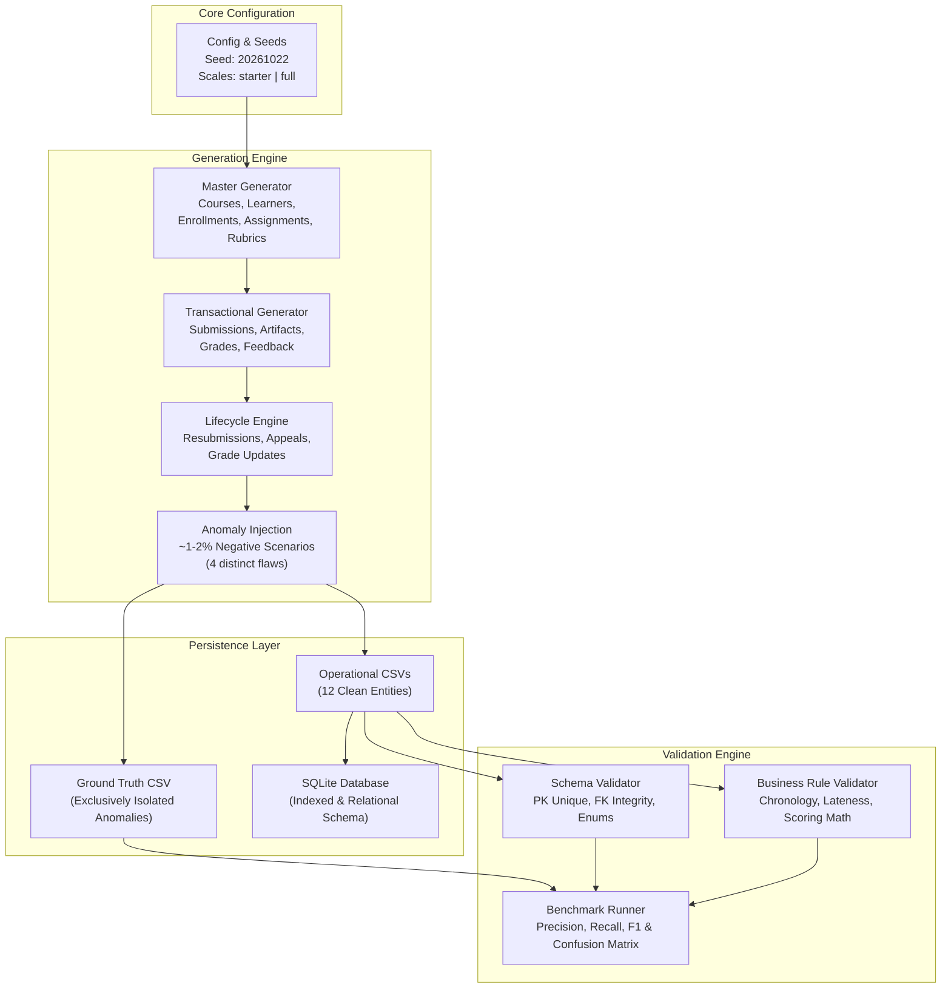
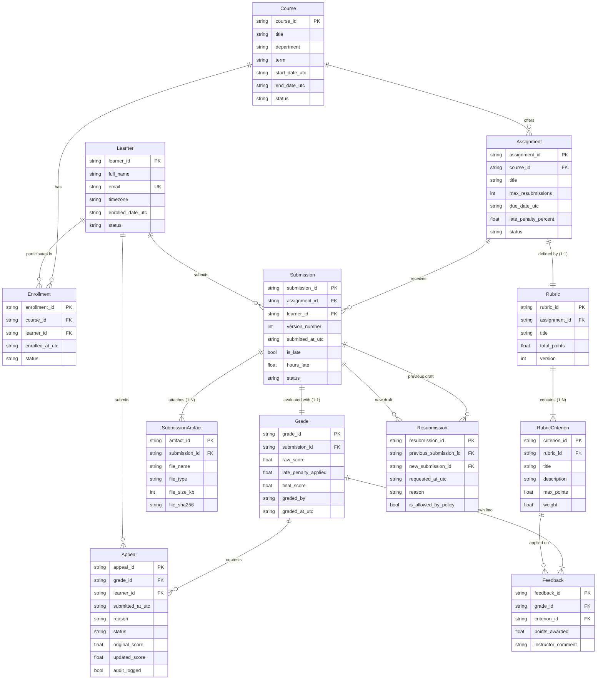
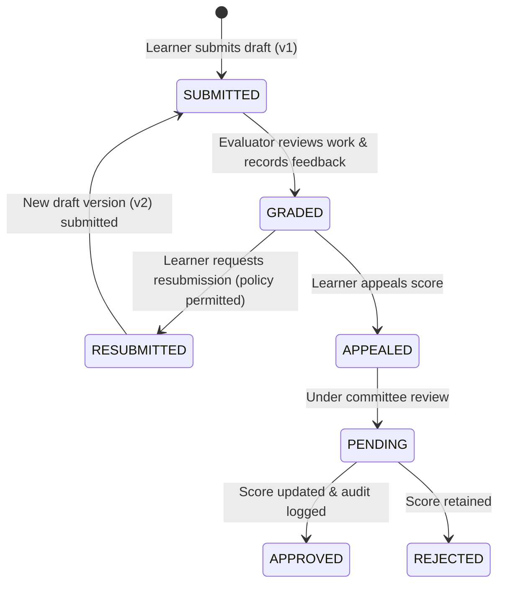

# System Architecture & Technical Design

This document details the architecture, relational data model, lifecycle event flows, deterministic random generation strategy, anomaly injection mechanics, and validation engine designed for the **Assignment Lifecycle & Synthetic Grading System**.

---

## 1. High-Level Architecture

The system operates across three decoupled layers: **Generator Pipeline**, **Persistence / Export Layer**, and **Validation & Anomaly Benchmark Engine**.

---

## 2. Entity-Relationship Diagram (ERD)

The relational schema comprises 12 operational entities organized into master records, submission transactions, rubric assessments, and post-grading lifecycle events.

---

## 3. Lifecycle State Machine & Chronological Event Flow

All events enforce strict chronological progression:

$$\text{Course.start\_date} \le \text{Assignment.due\_date} \le \text{Submission.submitted\_at} \le \text{Grade.graded\_at} \le \text{Appeal.submitted\_at}$$

---

## 4. Deterministic Reproducibility Strategy

To guarantee that running generation twice with seed `20261022` produces **bit-for-bit identical row counts and SHA-256 checksums**:
1. **Isolated PRNG Instance**: Rather than relying on global mutable PRNG state, an isolated `random.Random(seed)` instance is passed explicitly through all generation modules.
2. **Fixed Baseline Epochs**: All timestamps are calculated deterministically as integer offsets from fixed term epoch baselines (`2026-01-15T00:00:00Z` and `2026-08-25T00:00:00Z`).
3. **Canonical Float Rounding & Formatting**: All scores and penalties are strictly rounded to 2 decimal places (`round(x, 2)`) prior to serialization.
4. **Primary Key Sorting**: Prior to writing CSV artifacts, all rows are deterministically sorted by their canonical primary keys.
5. **Standardized Line Separators**: The CSV export engine enforces strict UNIX line terminators (`\n`) and explicit UTF-8 encoding across Windows, Linux, and macOS.

---

## 5. Anomaly Injection & Ground Truth Isolation

The framework injects 4 deliberate negative scenarios across a controlled subset (~1.5% to 2% of records):

1. **`UNENROLLED_LEARNER_SUBMISSION`**: A submission record is attributed to an assignment in a course where the learner has no active enrollment record in `Enrollment`.
2. **`GRADE_EXCEEDS_MAX`**: A `Grade.raw_score` and corresponding feedback points are artificially inflated above the `Rubric.total_points` (100.0).
3. **`DOUBLE_LATE_PENALTY`**: `Grade.late_penalty_applied` is deducted twice from the raw score, corrupting `final_score`.
4. **`UNAUDITED_APPEAL_GRADE_CHANGE`**: An appeal status is `APPROVED` and modifies `Grade.final_score`, but `Appeal.audit_logged` is set to `False`.

### Zero Ground Truth Leakage
- Operational CSV tables (`submissions.csv`, `grades.csv`, `appeals.csv`) contain **only** standard production fields.
- Anomaly metadata, flaw labels, and root causes are written exclusively to `data/ground_truth.csv`.

---

## 6. Validation Engine Architecture

The validator analyzes datasets without knowledge of the ground truth labels, executing:
- **Schema Validation Layer**: Checks primary key uniqueness, ID scheme regex, orphan foreign keys, non-null values, and enum sets.
- **Business Rule Layer**: Validates chronology, lateness math, feedback reconciliation ($\sum \text{feedback} == \text{raw}$), penalty calculations, and security audit log integrity.
- **Evaluation Runner**: Matches validator findings against `ground_truth.csv`, calculating:
  $$\text{Precision} = \frac{TP}{TP + FP}, \quad \text{Recall} = \frac{TP}{TP + FN}, \quad F_1 = 2 \times \frac{\text{Precision} \times \text{Recall}}{\text{Precision} + \text{Recall}}$$
